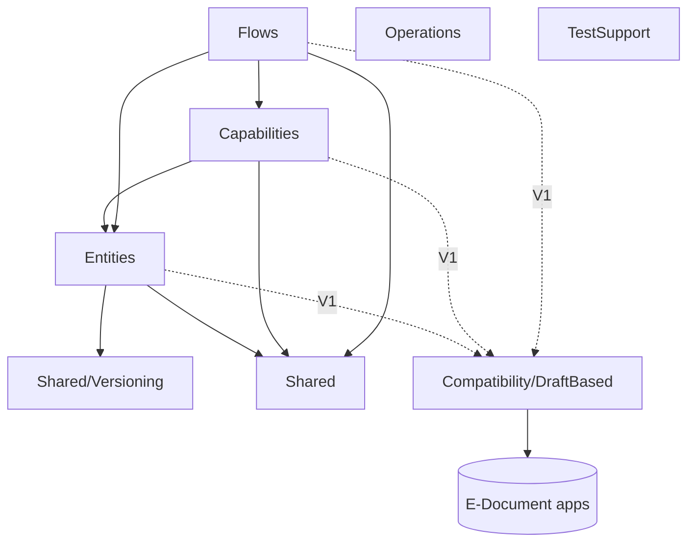

# Payables Agent's architecture

The aim of this document is to provide a high-level overview of the organizational concepts behind the code in the Payables Agent AL app application. This should be used to plan contributions to this codebase, and to aid reviewers in assesing whether a contribution is cohesive with the current model.

## Context: Business Central's Payables Agent

The Payables Agent is a per-company BC-agent-runtime agent. It deals with the creation of Purchase Invoices in Business Central from arbitrary input.

A BC-agent-runtime agent, is an LLM-based agent that operates on a logical client of Business Central with its own profile and user assigned. The loop definition of this agent is outside the AL codebase.

The Payables Agent supports the following user-level capabilities:
- Find an appropriate vendor for the intended invoice
- Suggest and create a vendor if it can't be found
- Filling in all header and line-level properties of the purchase document that can be interpreted from the input, or from history of how the users usually fill in these values.
- Creates both purchase invoices and purchase credit memos applied to applicable invoices.
- Match to existing purchase orders to invoice such orders when the invoice created by the Payables Agent is posted.

### Payables Agent V1 and V2

There are two versions of the Payables Agent, distinguished by the entity that they base their work on. In version 1, the agent operates by receiving an "E-Document" (which in practice is limited to only PDFs received via e-mail or uploaded manually) and creates a Purchase Invoice by processing the E-Document. In version 2, the received document is represented by a Payables Agent Work Item and the agent user directly creates the Purchase Invoice.

#### Version 1: Draft-based Payables Agent

An ad-hoc E-Document Service polls via the M365 connector, Outlook emails with PDF attachments, which are then interpreted as artificial E-Documents. When such an E-Document is created, an agent-framework task is created, which then goes and process the e-document into a purchase invoice. Note that the Payables Agent doesn't process other types of E-Documents (XML based, or sourced by other connectors than the email connector).

A lot of the functionality that the Payables Agent feature provides is really provided by the E-Document import processing pipeline. The responsiblities for the intake is split across different AL apps. The agent invokes processing steps which structure the received PDF by sending it to a MLLM, then store it into intermediate tables and run different approaches to fill Business Central values (including LLM approaches). The agent user doesn't fill in the values directly, but rather invokes the deterministic AL actions that suggest such values. And the AL actions themselves call the LLM for some of the properties.

After the E-Document processing pipeline has done it's best, the BC-agent-framework user defined in this app starts complementing the proposed values in the intermediate tables (known as the draft page). The PO matching functionality starts looking for open orders at this stage.

Once the user is satisfied with the values in the draft page, the agent proceeds with E-Document finalization; which creates a Purchase Invoice or, for a recognized vendor credit note, a Purchase Credit Memo.

> Note: Within this version, there is an ECS experiment that skips the E-Document-owned logic that fills in values and changes the agent prompt to do this logic itself instead. This experiment hasn't been enabled.

#### Version 2: Payables Agent

In this version, the entity at the center is the Payables Agent Work Item, owned by the Payables Agent app. There is no involvement of the E-Document processing framework.

The agent task is created with direct information about its source, the agent user directly consults it, and creates the appropriate Purchase Invoice directly, without any draft page.

> Note: V2 is under development, not activated for the end-user. Only to be activated after accuracy evidence and missing gaps have been resolved.

#### V1/V2 gaps

Backlog to resolve in dedicated efforts. Currently acknowledged gaps:

- Email sourcing: V1s sourcing of tasks is done via the E-Document framework. The plan is to bring the monitoring to this app for v2, inline with what SOA does (with the behavior that we have in v1). The `KnownSenders` capability should also apply in v2.
- Purchase credit memos: Recently added functionality for V1. We need to add AI E2E tests (different repository) that measure these scenarios, to have a baseline to compare against with V2. Instructions for creating Purchase Credit Memos will be required.
- OCV Customer feedback: V1 showed the button for supplying feedback in the draft page, we need to decide a new place for it that doesn't interfere with regular operations.
- Billing: V1 billing is based on the draft lines extracted. We still need to define the billing model impact for v2.
- V1 scenario coverage and making V2 match accuracy
    - PO matching: 
    - TtA mapping, history
    - Harms
- V1/V2 transition

## Code in this AL app

The code is organized in:
- `Flows`: High-level user-facing processes that this app defines for the Payables Agent feature.
- `Entities`: Definitions of persisted state that this app needs, and stateful wrappers when needed.
- `Capabilities`: Recognizable business scenario concerns that apply cross-flows.
- `Shared`: Common utilities used across for horizontal concerns. (missing better word)
- `Operations`: Side-responsibilities, currently only the clean-up tool needed to resolve a storage leak problem.
- `TestSupport`: Provides fixtures that the unit tests and AI E2E tests need. The tests are on a high level agnostic to the V1/V2 change. If there's something not exposed directly that is needed for a test, it should be here, rather than adding entry points unused in production paths in the other procedures.

Across the app, most things are agnostic to the Payables Agent version. Version-handling behavior is hidden under the implementation details of the `entities` that need them, and provide a common API that is version agnostic. All references to E-Documents and things needed exclusively for v1 are under `Compatibility`. Everything under `DraftBased` replicates the same folder structure, exclusively for v1 concerns only.

A high level picture of how these concepts interact together is that `Flows` orchestrate processes and have knowledge about both `Entities` and `Capabilities`. `Capabilities` may require `Entities`. `Shared` is available to all of the other concepts. Isolated dependencies are the versioning concerns and E-Documents dependency.

Folders depend on each other as follows (an arrow means "uses"):



### Flows

- Registration of the agent: Platform-hooks for registering the BC-agent-runtime agent.
- Configuring the Payables Agent: Creating, activating, reconfiguring, deactivating the agent, including applying and reconciling its runtime instructions. This can include functionality like sending demo invoices.
- Task intake: Source acquisition, acceptance/rejection policies, deduplication, handoff to the runtime.
- Task execution: The behavioral content of the prompt that the agent user follows, the profile, role center it uses and page customizations, outcome registration.
- Supervision: Human inspection of task progress, sources and outcomes.
- Upgrade: Schema data upgrades that have historically been required.

When defining flows, we use these patterns:

- Single authoritative source: Rather than multiple variants that touch the same parts of the process, a single configurable entry point for the flow that callers configure.
- Encapsulation of flow parameters: To configure the possible variants of a flow, we encapsulate such parameters in a single entity, for example the `PA Setup Update Parameters`. Keeping the procedure signature future-proof.

### Capabilities

- Customer feedback: Collects data that users may provide as part of input for next iterations of the Payables Agent.
- KPI: Collects rough metrics to display the work done by the agent. 
- Trial: Free-tier invoices the users have to try out the Payables Agent. 
- Known senders: Keeps track of the senders of tasks received that were previously accepted, to reduce the amount of times that the user is asked for authorization to process.
- Billing: Deals with emitting billable units for the processes done by the Payables Agent.

### Entities

Entities deal with persisting in database the records needed to keep track of the state that the Payables Agent feature needs. And also with providing an interface for the rest of the app to interact with these that preserves the invariants that we want to maintain when a data change is applied. A single table object may be enough for some cases, but for others where the source table may vary across versions, a wrapping codeunit is used, for example the `PASetup` codeunit.

When the entity uses a wrapping codeunit, all the other consumers should refer to such wrapping codeunits instead of directly to the tables that they wrap.

- `Setup`: Entity storing the setup of the Payables Agent, which involve different tables in v1 and v2.
- `WorkItem`: Entity storing what is considered a work item that may end up as an agent task for the Payables Agent. Also v1/v2 aware.
- `KnownSender`: Entity to store the data of the known-senders capability.
- `KPI`: Entity to store the data of the KPI capability.
- `Trial`: Entity to keep track of the trial.

### Shared mechanisms

Application-wide supporting mechanisms without a specific business scenario:

- Telemetry: Conventions for emitting telemetry.
- Security: Who can access the agent and permissionsets.
- Outcomes: Purchase-document outcome validation and document/vendor facts, with data-only temporary output.
- Versioning: Central place to define whether the agent uses v1 or v2. It's usages should be restricted and not filter across the code base.

### File system organization

```
Flows/
    Registration/                       Agent metadata, Copilot capability and install hooks
    Configuration/                      Setup page, setup update and validation, instructions, demo guide page
    Intake/                             Work item intake and the "New from PDF" upload
    Execution/
        AgentWorkspace/                 V2 agent profile, role center and agent-only dialog
        Supporting/                     Runtime callbacks, PDF text extraction, outcome/posting support and V2 agent permission sets
    Supervision/                        Human task monitoring, work item list and role center cues
    Upgrade/

Entities/
    Setup/                              Setup table and its version-aware wrapper
    WorkItem/                           Work item table, wrapper, collection and enums
    KnownSender/
    KPI/                                KPI record and scenario enum
    Trial/                              Trial state and lifecycle

Capabilities/
    Feedback/
    KnownSenders/                       Sender policy and review decisions
    KPI/                                KPI page and purchase-invoice event subscriber
    Trial/                              Trial guide page

Shared/
    Outcomes/                           Stateless validation and data-only facts for purchase-document outcomes
    Security/                           Agent access checks, entitlement, admin and read permission sets
    Telemetry/                          Shared emission and dimensions
    Versioning/                         Active V1/V2 selection and stored work-item version lookup

Compatibility/
    DraftBased/                         V1-only (E-Document) behavior, mirroring the folders above
        Flows/
            Configuration/              V1 setup and mailbox configuration
                DemoGuide/              Demo invoice emails
            Intake/                     V1 import operation and its admission subscribers
            Execution/
                AgentWorkspace/         V1 profile, role center and page customizations
        Entities/
            Setup/                      V1 setup storage (E-Document service and Outlook setup)
            WorkItem/                   V1 E-Document storage and legacy correlation
        Capabilities/
            Billing/
            Feedback/                   Draft page feedback
        Shared/
            Security/                   V1-only agent permission sets
            Telemetry/                  V1-only billing and demo-email events
        TestSupport/

Operations/
    EmailStorageCleanup/

TestSupport/                            App-owned semantic fixture API and version dispatch for test apps

_Obsolete/                              Whole-object obsoletion only; active owners retain obsolete members

.resources/
    Prompts/                            V2 agent instructions and PDF text extraction prompt
    DraftBasedPayablesAgent/
        Prompts/                        V1 agent instructions (default and agent-driven variants)
```

## Other code conventions

- All code is `internal` when possible (pages can't be), the extensibility of the agents is a separate story and not done via traditional AL extensions. Likewise, no events should be emitted.
- Full object obsoletions are moved to `_Obsolete`.
- Telemetry is centralized, no independent `Session.LogMessage`.
- Subscribers to critical business processes shouldn't fail.
- If an entity has a wrapper codeunit, only the codeunit queries directly the table, other consumers need to go through the entity.